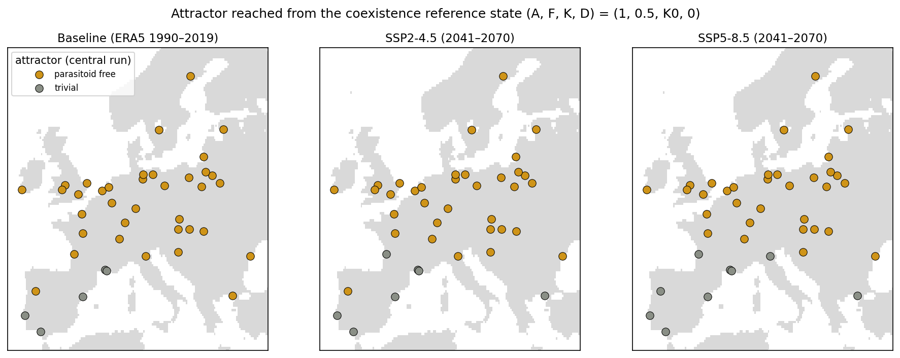
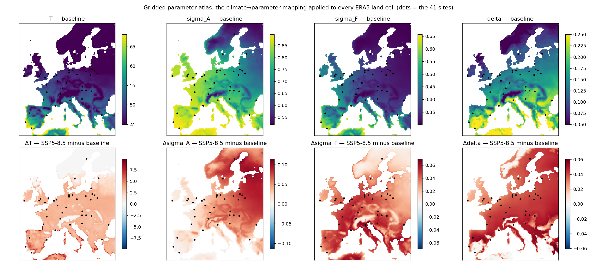
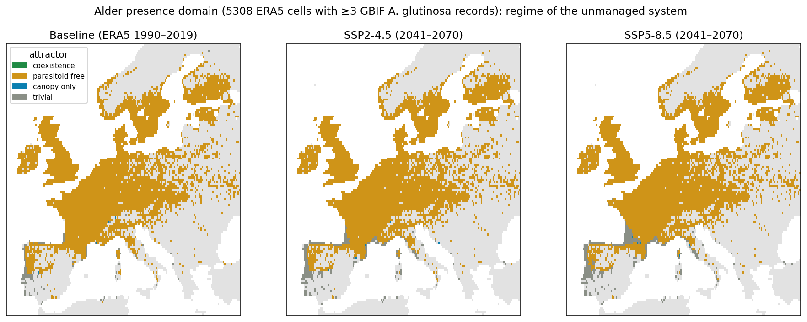
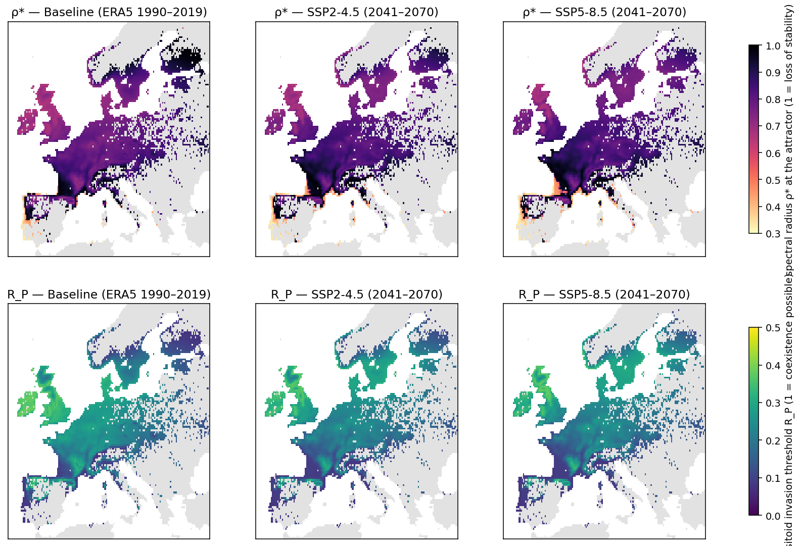

# AlderIPM v2 — climate-driven, site-specific stability atlas for the black-alder ecoepidemic system

**What v2 adds to AlderIPM-Sim (v1, Ghosh & Singh, 2026).** v1 analyses the alder–*Agelastica alni*–*Meigenia mutabilis*–passerine system for one calibrated parameter set and explores phenological variability as an abstract parameter space; the paper explicitly leaves out spatial variability and site-specific projection. v2 closes that gap with the data pipeline that was built for the `eco-forecast` project: ERA5 and CMIP6 climate, GBIF occurrences, and a reproducible Snakemake-style workflow, re-purposed so that the **climate drives the paper's phenological parameters** and the **unchanged AlderIPM-Sim engine** computes stability, regime-shift probability and management cost for every one of the 41 Natura 2000 (91E0*) alder sites already shipped with the app, under the ERA5 baseline (1990–2019) and two CMIP6 futures (SSP2-4.5 and SSP5-8.5, 2041–2070).

```
ERA5 daily climatology (WB2) ─┐
CMIP6 Δ (4 ISIMIP3b GCMs)    ─┼─► climate drivers per site ─► param_map ─► AlderIPM-Sim engine (model.js, control.js)
GBIF (alder, beetle, parasitoid, birds) ─┘      (winter T, days>10 °C, May–Jul T)   (T, σ_A, σ_F, δ)      │
                                                                                                    ▼
                                             report.md · summary.csv · figures/ · web/data/alder_sites_v2.json ─► web/v2 (map + live engine)
```

## Repository layout

```
config/v2.yaml                 all settings (sites, box, GCMs, mapping, uncertainty)
pipeline/climate_sites.py      1. ERA5 daily climatology + CMIP6 monthly deltas -> site & grid indices   (cached, resumable)
pipeline/gbif_sites.py         2. GBIF counts within 25 km, bird reporting ratio, A. alni monthly phenology (resumable)
pipeline/gbif_grid.py          2b. GBIF maps-API density tiles -> 0.25 deg alder presence domain (5,308 cells)
pipeline/param_map.py          3. climate -> phenological parameters, anchored at the calibrated set; LHS uncertainty samples
pipeline/engine.js             loads the app's parameters.js / model.js / control.js unchanged into Node
pipeline/run_sites.js          4. stability atlas: attractor, ρ*, R_P, R1, R2, D*, K*, P_shift, strategies A/B/C per site × scenario
pipeline/param_map_grid.py     3b. mapping applied to every domain cell
pipeline/run_grid.js           4b. central run for every domain cell (resumable; --seconds / --max)
pipeline/report_grid.py        5b. gridded atlas: netCDF, area statistics, transitions, figures, web rasters
pipeline/report.py             5. tables, maps, web layer
pipeline/site_params_api.py    use the layer from Python (alder_ipm_sim package)
data/                          climate_sites.csv, climate_grid.nc (0.25°, Europe), gbif_sites.csv, site_params.json, era5/cmip6 caches
results/                       report.md, summary.csv, site_results.{json,csv}, figures/, provenance/
web/                           copy of alder-ipm-sim-web with web/v2/ (new page) and web/data/alder_sites_v2.json (new layer)
run.sh                         the whole pipeline in order
```

## Run

```bash
./run.sh                                  # ~45 min on one core; climate and GBIF stages cache and resume
python3 web/serve.py                      # then open http://localhost:8000/v2/
```
No accounts or credentials are needed: ERA5 comes from the WeatherBench 2 public Zarr, CMIP6 from the Pangeo Google Cloud archive, occurrences from the GBIF search API.

## Method

### 1. Climate drivers
Daily-mean 2 m temperature and daily precipitation by day of year from the ERA5 climatology 1990–2019 (0.25°; Rasp et al., 2024) give, per site (nearest cell) and per grid cell: winter mean temperature (Dec–Feb), frost days, days above 5 °C and 10 °C (`gsl5`, `gsl10`), growing-degree-days above 10 °C, May–July mean temperature (`T_MJJ`, the larval window), annual and May–August precipitation. Future drivers use the delta method: the ensemble-mean monthly change (difference for temperature, ratio for precipitation) between 1985–2014 and 2041–2070 in GFDL-ESM4, IPSL-CM6A-LR, MPI-ESM1-2-HR and MRI-ESM2-0 (the ISIMIP3b primary set; Lange, 2019) is applied to the daily climatology and the indices are recomputed. The inter-model standard deviation of the winter, May–July and annual changes is kept for the uncertainty analysis. Because indices are computed from a 30-year mean daily cycle, threshold counts (frost days, days > 10 °C) are climatological and smoother than year-by-year values.

### 2. GBIF context
For every site, record counts (2000–2026, with coordinates) of *Alnus glutinosa*, *A. alni*, *M. mutabilis*, eight generalist insectivorous passerines and all Aves within 25 km, and the monthly histogram of *A. alni* records within 100 km. Pooled across sites the beetle shows the expected two adult peaks (April–May, overwintered adults; August, new generation) separated by a July trough, i.e. the larval window the model integrates over (`results/figures/gbif_beetle_phenology.png`). *M. mutabilis* has only a handful of records at any site, so the parasitoid cannot be mapped from occurrences and stays a parameter. The passerine/Aves reporting ratio was computed as a candidate effort-corrected proxy for bird pressure but is **not used**: it is dominated by observer culture (wetland birding hotspots report few passerines), so `B_index` stays at its calibrated value.

### 3. Climate → phenological parameters
Four of the paper's nine climate-linked phenologies have a driver that ERA5/CMIP6 can supply. Each mapping is monotone, anchored so that at the reference site (`neusiedler`, Austria, the region of the calibration) the baseline climate returns exactly the calibrated AlderIPM-Sim value, and clipped to the app's PARAM_REGISTRY range:

| parameter | paper phenology | driver | form | default slope / assumption |
|---|---|---|---|---|
| T, larval-window / season length | #1 season length under warming (measurable by GDD) | `gsl10` | T = T_ref (gsl10 / gsl10_ref)^0.5 | half-elastic; range 45–70 d |
| σ_A, beetle overwinter survival | #2 reduced winter severity (beetle) | winter T | logit-linear, +0.30 logit per °C | milder winters raise survival |
| σ_F, parasitoid overwinter survival | #3 reduced winter severity (parasitoid) | winter T | logit-linear, +0.30 logit per °C | as above, puparia in soil |
| δ, parasitoid emergence rate | #4 faster development in a warmer climate | `T_MJJ` | degree-day: δ = δ_ref (T_MJJ − 8 °C)/(T_MJJ,ref − 8 °C) | linear development rate above 8 °C |

The slopes are literature-informed assumptions, not fitted relations; they are therefore varied in the uncertainty analysis (multiplier ~ N(1, slope_cv), cv = 0.3–0.5), together with the GCM spread of the site's temperature change. Eighty Latin-hypercube samples per site × scenario (Marino et al., 2008 design, as in the paper) give the **climate-conditional regime-shift probability** `P_shift`: the fraction of samples whose annual map, started from the coexistence reference state (A, F, K, D) = (1, 0.5, K₀, 0), converges to a non-coexistence attractor. All other parameters stay at the calibrated values, so scenario differences are attributable to climate alone.

### 4. Stability atlas
`run_sites.js` loads the app's `model.js` and `control.js` unchanged. For every site × scenario it iterates the annual map 200 years from the reference state, classifies the attractor (coexistence / parasitoid-free / canopy-only / trivial), evaluates the spectral radius ρ* of the Jacobian there, R_P (Eq. 11, variational form used by the app), resistance R1 and resilience R2, equilibrium defoliation D* and capacity K*, and runs the app's `ControlComparator` (strategies A: parasitoid augmentation; B: + bird-habitat enhancement; C: fully integrated; grid search, 50-year horizon, feasibility = ρ* < 1 at the managed equilibrium).

## Results (run of 25 Oct 2026)

| scenario | sites | parasitoid-free | beetle-free (trivial) | coexistence | sites with R_P > 1 | mean ρ* (parasitoid-free sites) | mean J (strategy C) |
|---|---|---|---|---|---|---|---|
| Baseline 1990–2019 | 41 | 36 | 5 | 0 | 0 | 0.772 | 144.6 |
| SSP2-4.5 2041–2070 | 41 | 34 | 7 | 0 | 0 | 0.777 | 148.6 |
| SSP5-8.5 2041–2070 | 41 | 32 | 9 | 0 | 0 | 0.754 | 150.5 |

1. **No site supports endemic parasitoidism without augmentation.** R_P ranges 0.07–0.38 at baseline and falls slightly under warming (−0.02 to −0.03 on average); P_shift = 1 for every site and scenario, i.e. none of the 80 climate-conditional samples per site reaches coexistence. This is the spatial counterpart of the paper's result that the parasitoid-free state is the most frequent regime.
2. **Climate moves sites across the beetle-persistence boundary, not the coexistence boundary.** Five Mediterranean sites (Camargue, Rhône delta, Doñana, Ebro delta, Tagus estuary) are already beetle-free at baseline (A* = 0, K* = K₀, D* = 0): with a mapped season length of 59–68 days, within-season predation and mortality exceed Beverton–Holt recruitment. Four more (Gironde, Po delta, Evros delta, Trás-os-Montes) cross under SSP5-8.5; all four sit at ρ* = 0.98–0.99 at baseline, i.e. at the edge of the parasitoid-free regime. The northernmost site (Vindel River, σ_A = 0.56 from cold winters) is at the same edge from the cold side, so the parasitoid-free regime is bounded by climate at both ends.
3. **Where the beetle persists, warming lowers resilience and raises management cost.** Across the 32–34 sites that stay parasitoid-free, ρ* rises at 29 (mean +0.03 under SSP2-4.5, +0.05 under SSP5-8.5; resilience R2 falls by 0.07–0.11) while equilibrium defoliation D* falls slightly (−0.03 to −0.04). The cost of fully integrated control (strategy C) rises by 2.8 % and 4.1 % on average (up to 5.2 %); C remains the cheapest feasible strategy at every site and scenario.
4. **Season length is the decisive driver**, which is the phenology the paper identifies as the most tractable early-warning candidate (measurable by growing-degree-days): it alone moves sites across the persistence boundary, whereas the winter-survival and development-rate pathways change ρ* and R_P within the regime.




Full tables: `results/report.md`, `results/summary.csv`; per-sample classes and strategy details: `results/site_results.json`; maps: `results/figures/`.


## Gridded domain: every 0.25° cell where black alder is recorded

The 41 Natura 2000 sites are only the reference points inherited from v1; the atlas proper runs on the **alder presence domain**: every ERA5 land cell (0.25°, box 12°W–32°E, 35–67°N) with at least three GBIF *A. glutinosa* records 2000–2026 (GBIF maps API density tiles, `pipeline/gbif_grid.py`) — 5,308 cells, 42.9 % of the land area in the box. The mapping of `pipeline/param_map_grid.py` and the central run of `pipeline/run_grid.js` (attractor, ρ*, R_P, D*, K*; no LHS and no strategy costs at grid level) are applied to all of them for the three scenarios (`results/grid_atlas.nc`, `results/grid_summary.csv`, `results/grid_transitions.csv`; rasters and click-through values in `web/v2`).

| Scenario | Parasitoid-free (% of alder area) | Beetle-free | Canopy-only | Coexistence | Cells with R_P > 1 | Mean ρ* (parasitoid-free) |
|---|---|---|---|---|---|---|
| Baseline | 97.2 | 2.7 | 0.1 | 0.0 | 0 | 0.819 |
| SSP2-4.5 | 94.6 | 5.3 | 0.1 | 0.0 | 0 | 0.832 |
| SSP5-8.5 | 92.9 | 7.0 | 0.1 | 0.0 | 0 | 0.835 |

The grid confirms the site picture at continental scale: the parasitoid-free regime covers the whole temperate range, R_P stays below 1 everywhere, and warming moves 2.6 % (SSP2-4.5) and 4.3 % (SSP5-8.5) of the alder area from parasitoid-free to beetle-free along the Mediterranean margin (Iberia, southern France, Po plain, Aegean coast), while ρ* rises across the temperate core (mean +0.013 to +0.016 over the parasitoid-free area; `results/figures/grid_delta_rho.png`).




Domain caveats: GBIF recording density, not alder abundance, shapes the domain, so eastern Europe, the Balkans and Russia are under-represented and the Atlantic–Central European core is complete; the chorological map of Caudullo et al. (2017) is the recommended substitute or validation layer (`domain_min_records` and the domain rule are in `config/v2.yaml`). Records within a cell may include planted or urban trees.

## How to use the layer

- **Web:** `web/v2/index.html` — choose a scenario and a raster layer (regime or ρ*), click any alder cell for its values, click a reference site: climate drivers with their change, mapped parameters next to the calibrated values, stability metrics, strategy costs, a *Run live* button that re-simulates the site with the same engine, and *Copy parameter set* to paste into the main app, R or Python.
- **Python:** `from site_params_api import site_params; AlderIPMSimModel(site_params("rhine_alluvial", "ssp585"))`.
- **Main app:** `web/data/alder_sites_v2.json` has the same site ids as `alder_sites.json`; the Location tab's `climate_driven` adjustments in `metadatabase.json` can be replaced by the `params` block of this file.

## Limitations

1. The climate→parameter slopes are assumptions. The ranking of sites and the sign of scenario effects are robust to them (they are monotone and bounded), the magnitudes are not; fitting them needs the beetle-density, parasitism-prevalence and predation time series the paper calls for.
2. Five of the nine phenologies (β, R_B, μ_S, φ, B_index) have no defensible climate driver yet and stay at calibrated values.
3. ERA5 at 0.25° does not resolve the microclimate of riparian strips; a 1-km baseline (CHELSA; Karger et al., 2017) can be substituted in `climate_sites.py` without changing the rest.
4. The strategy comparison uses the app's grid-search optimiser and default cost weights, not the forward–backward sweep of the paper; use it for relative, not absolute, costs.
5. GBIF counts are search-API results without a download DOI; register a derived dataset before publishing.

## References

Caudullo, G., Welk, E., & San-Miguel-Ayanz, J. (2017). Chorological maps for the main European woody species. *Data in Brief, 12*, 662–666. https://doi.org/10.1016/j.dib.2017.05.007
Ghosh, S., & Singh, S. (2026). Adaptive stability of the black alder ecoepidemic system: Integrated intervention alone prevents regime shift under phenological variability. *Frontiers in Applied Mathematics and Statistics, 12*, 1831903.
Karger, D. N., Conrad, O., Böhner, J., Kawohl, T., Kreft, H., Soria-Auza, R. W., Zimmermann, N. E., Linder, H. P., & Kessler, M. (2017). Climatologies at high resolution for the earth's land surface areas. *Scientific Data, 4*, 170122. https://doi.org/10.1038/sdata.2017.122
Lange, S. (2019). Trend-preserving bias adjustment and statistical downscaling with ISIMIP3BASD (v1.0). *Geoscientific Model Development, 12*(7), 3055–3070. https://doi.org/10.5194/gmd-12-3055-2019
Marino, S., Hogue, I. B., Ray, C. J., & Kirschner, D. E. (2008). A methodology for performing global uncertainty and sensitivity analysis in systems biology. *Journal of Theoretical Biology, 254*(1), 178–196. https://doi.org/10.1016/j.jtbi.2008.04.011
Rasp, S., Hoyer, S., Merose, A., Langmore, I., Battaglia, P., Russell, T., Sanchez-Gonzalez, A., Yang, V., Carver, R., Agrawal, S., Chantry, M., Ben Bouallegue, Z., Dueben, P., Bromberg, C., Sisk, J., Barrington, L., Bell, A., & Sha, F. (2024). WeatherBench 2: A benchmark for the next generation of data-driven global weather models. *Journal of Advances in Modeling Earth Systems, 16*, e2023MS004019. https://doi.org/10.1029/2023MS004019
