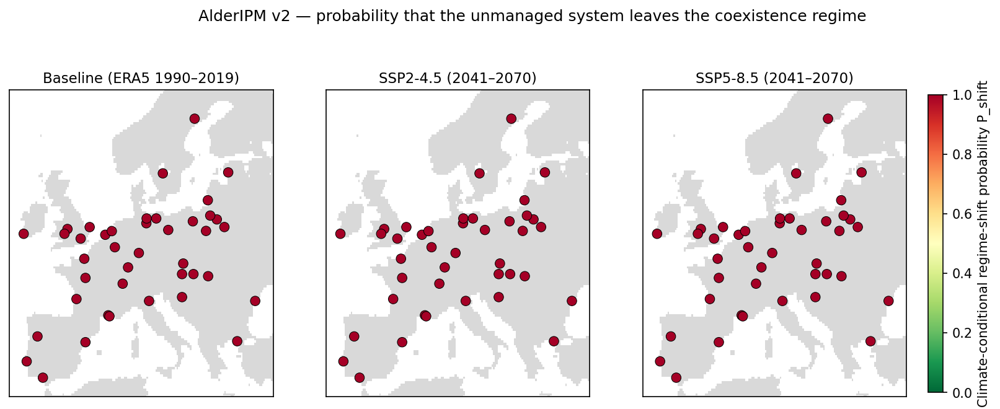
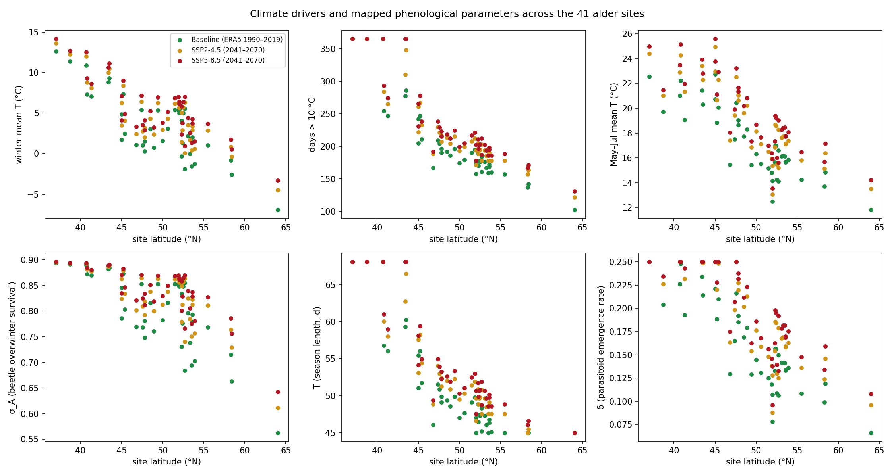
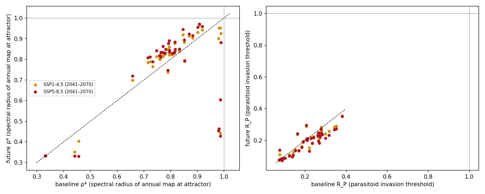
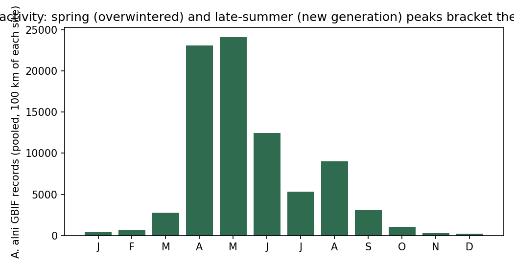

# AlderIPM v2 — climate-driven, site-specific stability atlas

Generated 2026-10-24 23:54 UTC. Engine: unchanged AlderIPM-Sim web model (model.js/control.js). Reference site for the calibrated parameter set: **neusiedler**. Initial condition [1, 0.5, 'K_0', 0]; 200 annual-map iterations (central), 120 for the 80 LHS samples per site × scenario.

## Data sources

- Climate baseline: WeatherBench 2 ERA5 climatology 1990-2019, 0.25 deg (https://storage.googleapis.com/weatherbench2/datasets/era5-hourly-climatology/1990-2019_6h_1440x721.zarr).
- Climate change: ensemble-mean delta of GFDL-ESM4, IPSL-CM6A-LR, MPI-ESM1-2-HR, MRI-ESM2-0 ([2041, 2070] vs [1985, 2014]), Pangeo CMIP6 (Google Cloud). Regional mean changes:

| GCM | scenario | ΔT annual (°C) | ΔP annual (%) |
|---|---|---|---|
| GFDL-ESM4 | ssp245 | 1.30 | +1.7 |
| GFDL-ESM4 | ssp585 | 1.93 | -0.1 |
| IPSL-CM6A-LR | ssp245 | 1.84 | -3.1 |
| IPSL-CM6A-LR | ssp585 | 2.73 | -4.0 |
| MPI-ESM1-2-HR | ssp245 | 1.32 | -3.2 |
| MPI-ESM1-2-HR | ssp585 | 1.80 | -2.4 |
| MRI-ESM2-0 | ssp245 | 1.40 | -0.1 |
| MRI-ESM2-0 | ssp585 | 1.99 | -0.8 |

- Occurrences: GBIF occurrence search API, 2000–2026, retrieved 2026-10-24 22:44:58 UTC; keys: Alnus glutinosa = 2876213, Agelastica alni = 1047936, Meigenia mutabilis = 1476844 (GBIF Backbone). No download DOI — register a derived dataset before publication.

## Climate → parameter mapping

| parameter | driver | form | assumption |
|---|---|---|---|
| T | gsl10 | proportional | elasticity=0.5, slope_cv=0.4 |
| sigma_A | winter_T | logit_linear | slope_per_C=0.3, slope_cv=0.5 |
| sigma_F | winter_T | logit_linear | slope_per_C=0.3, slope_cv=0.5 |
| delta | T_MJJ | degree_day | T0_C=8.0, slope_cv=0.3 |
| B_index | bird_ratio | proportional | elasticity=0.5, slope_cv=0.5, enabled=False |

All other parameters stay at the calibrated AlderIPM-Sim values. Mapped values are clipped to the PARAM_REGISTRY ranges.

## Site results (central run)

| site | country | scenario | attractor | rho_star | R_P | D_star | K_star | P_shift | P_parasitoid_free | cheapest_feasible | p_T | p_sigma_A | p_sigma_F | p_delta | c_winter_T | c_gsl10 |
|---|---|---|---|---|---|---|---|---|---|---|---|---|---|---|---|---|
| bialowieza | Poland | baseline | parasitoid_free | 0.834 | 0.190 | 0.171 | 1.699 | 1 | 1.000 | Strategy C | 45.226 | 0.684 | 0.325 | 0.150 | -1.874 | 161 |
| bialowieza | Poland | ssp245 | parasitoid_free | 0.839 | 0.194 | 0.168 | 1.699 | 1 | 1.000 | Strategy C | 47.554 | 0.741 | 0.343 | 0.179 | 0.054 | 178 |
| bialowieza | Poland | ssp585 | parasitoid_free | 0.849 | 0.190 | 0.160 | 1.700 | 1 | 1.000 | Strategy C | 48.741 | 0.766 | 0.354 | 0.192 | 0.952 | 187 |
| biebrza | Poland | baseline | parasitoid_free | 0.814 | 0.206 | 0.190 | 1.697 | 1 | 1.000 | Strategy C | 45.000 | 0.694 | 0.328 | 0.141 | -1.534 | 159 |
| biebrza | Poland | ssp245 | parasitoid_free | 0.829 | 0.205 | 0.179 | 1.698 | 1 | 1.000 | Strategy C | 47.554 | 0.751 | 0.347 | 0.169 | 0.389 | 178 |
| biebrza | Poland | ssp585 | parasitoid_free | 0.834 | 0.206 | 0.175 | 1.699 | 1 | 1.000 | Strategy C | 48.610 | 0.776 | 0.360 | 0.182 | 1.322 | 186 |
| camargue | France | baseline | trivial | 0.440 | 0.087 | 0.000 | 1.712 | 1 | 0.425 | Strategy C | 60.278 | 0.884 | 0.563 | 0.214 | 9.293 | 286 |
| camargue | France | ssp245 | trivial | 0.351 | 0.076 | 0.000 | 1.712 | 1 | 0.163 | Strategy C | 66.491 | 0.889 | 0.593 | 0.249 | 10.481 | 348 |
| camargue | France | ssp585 | trivial | 0.331 | 0.074 | 0.000 | 1.712 | 1 | 0.150 | Strategy C | 68.096 | 0.891 | 0.607 | 0.250 | 11.116 | 365 |
| danube_delta | Romania | baseline | parasitoid_free | 0.902 | 0.141 | 0.106 | 1.704 | 1 | 1.000 | Strategy C | 51.033 | 0.786 | 0.366 | 0.221 | 1.743 | 205 |
| danube_delta | Romania | ssp245 | parasitoid_free | 0.931 | 0.124 | 0.076 | 1.706 | 1 | 1.000 | Strategy C | 53.107 | 0.824 | 0.401 | 0.250 | 3.492 | 222 |
| danube_delta | Romania | ssp585 | parasitoid_free | 0.956 | 0.106 | 0.049 | 1.708 | 1 | 0.988 | Strategy C | 54.172 | 0.835 | 0.416 | 0.250 | 4.128 | 231 |
| danube_hu | Hungary | baseline | parasitoid_free | 0.883 | 0.152 | 0.125 | 1.702 | 1 | 1.000 | Strategy C | 49.130 | 0.748 | 0.346 | 0.185 | 0.310 | 190 |
| danube_hu | Hungary | ssp245 | parasitoid_free | 0.903 | 0.141 | 0.105 | 1.704 | 1 | 1.000 | Strategy C | 51.281 | 0.793 | 0.371 | 0.220 | 2.013 | 207 |
| danube_hu | Hungary | ssp585 | parasitoid_free | 0.915 | 0.135 | 0.093 | 1.705 | 1 | 1.000 | Strategy C | 52.263 | 0.812 | 0.388 | 0.232 | 2.890 | 215 |
| donana | Spain | baseline | trivial | 0.332 | 0.078 | 0.000 | 1.712 | 1 | 0.138 | Strategy C | 68.096 | 0.894 | 0.636 | 0.250 | 12.655 | 365 |
| donana | Spain | ssp245 | trivial | 0.333 | 0.079 | 0.000 | 1.712 | 1 | 0.150 | Strategy C | 68.096 | 0.896 | 0.650 | 0.250 | 13.612 | 365 |
| donana | Spain | ssp585 | trivial | 0.333 | 0.080 | 0.000 | 1.712 | 1 | 0.150 | Strategy C | 68.096 | 0.896 | 0.657 | 0.250 | 14.144 | 365 |
| ebro_delta | Spain | baseline | trivial | 0.331 | 0.073 | 0.000 | 1.712 | 1 | 0.138 | Strategy C | 68.096 | 0.890 | 0.602 | 0.226 | 10.871 | 365 |
| ebro_delta | Spain | ssp245 | trivial | 0.332 | 0.076 | 0.000 | 1.712 | 1 | 0.138 | Strategy C | 68.096 | 0.893 | 0.625 | 0.250 | 11.988 | 365 |
| ebro_delta | Spain | ssp585 | trivial | 0.332 | 0.077 | 0.000 | 1.712 | 1 | 0.150 | Strategy C | 68.096 | 0.894 | 0.634 | 0.250 | 12.531 | 365 |
| elbe_lower | Germany | baseline | parasitoid_free | 0.772 | 0.270 | 0.236 | 1.694 | 1 | 1.000 | Strategy C | 47.286 | 0.796 | 0.374 | 0.141 | 2.155 | 176 |
| elbe_lower | Germany | ssp245 | parasitoid_free | 0.815 | 0.242 | 0.196 | 1.697 | 1 | 1.000 | Strategy C | 49.645 | 0.825 | 0.402 | 0.168 | 3.554 | 194 |
| elbe_lower | Germany | ssp585 | parasitoid_free | 0.832 | 0.232 | 0.179 | 1.698 | 1 | 1.000 | Strategy C | 50.658 | 0.839 | 0.423 | 0.178 | 4.408 | 202 |
| estonian_coast | Estonia | baseline | parasitoid_free | 0.853 | 0.162 | 0.151 | 1.700 | 1 | 1.000 | Strategy C | 45.000 | 0.663 | 0.321 | 0.119 | -2.582 | 142 |
| estonian_coast | Estonia | ssp245 | parasitoid_free | 0.790 | 0.237 | 0.215 | 1.696 | 1 | 1.000 | Strategy C | 45.506 | 0.729 | 0.338 | 0.146 | -0.370 | 163 |
| estonian_coast | Estonia | ssp585 | parasitoid_free | 0.794 | 0.243 | 0.213 | 1.696 | 1 | 1.000 | Strategy C | 46.609 | 0.756 | 0.349 | 0.159 | 0.576 | 171 |
| evros_delta | Greece | baseline | parasitoid_free | 0.987 | 0.088 | 0.002 | 1.712 | 1 | 0.725 | Strategy C | 56.805 | 0.872 | 0.506 | 0.248 | 7.311 | 254 |
| evros_delta | Greece | ssp245 | trivial | 0.443 | 0.086 | 0.000 | 1.712 | 1 | 0.412 | Strategy C | 60.066 | 0.882 | 0.548 | 0.250 | 8.765 | 284 |
| evros_delta | Greece | ssp585 | trivial | 0.429 | 0.085 | 0.000 | 1.712 | 1 | 0.350 | Strategy C | 61.011 | 0.884 | 0.563 | 0.250 | 9.299 | 293 |
| gironde | France | baseline | parasitoid_free | 0.980 | 0.103 | 0.023 | 1.710 | 1 | 0.875 | Strategy C | 56.017 | 0.873 | 0.508 | 0.189 | 7.373 | 247 |
| gironde | France | ssp245 | trivial | 0.901 | 0.089 | 0.000 | 1.712 | 1 | 0.575 | Strategy C | 58.241 | 0.879 | 0.537 | 0.220 | 8.363 | 267 |
| gironde | France | ssp585 | trivial | 0.454 | 0.089 | 0.000 | 1.712 | 1 | 0.475 | Strategy C | 59.429 | 0.883 | 0.556 | 0.228 | 9.038 | 278 |
| hornborgasjon | Sweden | baseline | parasitoid_free | 0.790 | 0.206 | 0.214 | 1.696 | 1 | 1.000 | Strategy C | 45.000 | 0.715 | 0.334 | 0.099 | -0.829 | 137 |
| hornborgasjon | Sweden | ssp245 | parasitoid_free | 0.738 | 0.289 | 0.264 | 1.692 | 1 | 1.000 | Strategy C | 45.000 | 0.763 | 0.353 | 0.124 | 0.860 | 157 |
| hornborgasjon | Sweden | ssp585 | parasitoid_free | 0.746 | 0.295 | 0.259 | 1.692 | 1 | 1.000 | Strategy C | 46.061 | 0.786 | 0.366 | 0.134 | 1.733 | 167 |
| hortobagy | Hungary | baseline | parasitoid_free | 0.919 | 0.124 | 0.088 | 1.705 | 1 | 1.000 | Strategy C | 50.908 | 0.768 | 0.356 | 0.216 | 1.037 | 204 |
| hortobagy | Hungary | ssp245 | parasitoid_free | 0.943 | 0.111 | 0.063 | 1.707 | 1 | 0.975 | Strategy C | 52.987 | 0.810 | 0.385 | 0.250 | 2.775 | 221 |
| hortobagy | Hungary | ssp585 | parasitoid_free | 0.959 | 0.101 | 0.046 | 1.709 | 1 | 0.975 | Strategy C | 53.937 | 0.825 | 0.402 | 0.250 | 3.558 | 229 |
| jura_valley | Switzerland | baseline | parasitoid_free | 0.763 | 0.264 | 0.242 | 1.693 | 1 | 1.000 | Strategy C | 46.061 | 0.769 | 0.356 | 0.129 | 1.074 | 167 |
| jura_valley | Switzerland | ssp245 | parasitoid_free | 0.815 | 0.230 | 0.195 | 1.697 | 1 | 1.000 | Strategy C | 48.871 | 0.802 | 0.378 | 0.163 | 2.397 | 188 |
| jura_valley | Switzerland | ssp585 | parasitoid_free | 0.811 | 0.248 | 0.200 | 1.697 | 1 | 1.000 | Strategy C | 49.388 | 0.821 | 0.397 | 0.175 | 3.330 | 192 |
| kampinoska | Poland | baseline | parasitoid_free | 0.817 | 0.211 | 0.189 | 1.698 | 1 | 1.000 | Strategy C | 46.473 | 0.730 | 0.339 | 0.156 | -0.311 | 170 |
| kampinoska | Poland | ssp245 | parasitoid_free | 0.839 | 0.202 | 0.171 | 1.699 | 1 | 1.000 | Strategy C | 48.871 | 0.779 | 0.362 | 0.186 | 1.458 | 188 |
| kampinoska | Poland | ssp585 | parasitoid_free | 0.848 | 0.200 | 0.162 | 1.700 | 1 | 1.000 | Strategy C | 49.900 | 0.801 | 0.378 | 0.198 | 2.378 | 196 |
| killarney | Ireland | baseline | parasitoid_free | 0.657 | 0.381 | 0.342 | 1.686 | 1 | 1.000 | Strategy C | 45.000 | 0.854 | 0.451 | 0.078 | 5.442 | 158 |
| killarney | Ireland | ssp245 | parasitoid_free | 0.698 | 0.354 | 0.307 | 1.689 | 1 | 1.000 | Strategy C | 46.609 | 0.856 | 0.456 | 0.088 | 5.624 | 171 |
| killarney | Ireland | ssp585 | parasitoid_free | 0.719 | 0.351 | 0.289 | 1.690 | 1 | 1.000 | Strategy C | 47.554 | 0.862 | 0.471 | 0.096 | 6.143 | 178 |
| lithuanian_dunes | Lithuania | baseline | parasitoid_free | 0.733 | 0.279 | 0.269 | 1.691 | 1 | 1.000 | Strategy C | 45.000 | 0.768 | 0.356 | 0.108 | 1.042 | 157 |
| lithuanian_dunes | Lithuania | ssp245 | parasitoid_free | 0.765 | 0.283 | 0.243 | 1.693 | 1 | 1.000 | Strategy C | 47.554 | 0.811 | 0.387 | 0.136 | 2.857 | 178 |
| lithuanian_dunes | Lithuania | ssp585 | parasitoid_free | 0.789 | 0.269 | 0.222 | 1.695 | 1 | 1.000 | Strategy C | 48.871 | 0.828 | 0.406 | 0.148 | 3.700 | 188 |
| loire_valley | France | baseline | parasitoid_free | 0.846 | 0.221 | 0.166 | 1.699 | 1 | 1.000 | Strategy C | 51.528 | 0.853 | 0.449 | 0.165 | 5.391 | 209 |
| loire_valley | France | ssp245 | parasitoid_free | 0.919 | 0.152 | 0.090 | 1.705 | 1 | 1.000 | Strategy C | 54.055 | 0.864 | 0.479 | 0.198 | 6.428 | 230 |
| loire_valley | France | ssp585 | parasitoid_free | 0.945 | 0.132 | 0.062 | 1.707 | 1 | 0.900 | Strategy C | 54.987 | 0.871 | 0.501 | 0.207 | 7.154 | 238 |
| lonjsko_polje | Croatia | baseline | parasitoid_free | 0.908 | 0.138 | 0.100 | 1.704 | 1 | 1.000 | Strategy C | 51.774 | 0.803 | 0.379 | 0.210 | 2.471 | 211 |
| lonjsko_polje | Croatia | ssp245 | parasitoid_free | 0.966 | 0.098 | 0.038 | 1.709 | 1 | 0.950 | Strategy C | 54.406 | 0.834 | 0.414 | 0.248 | 4.065 | 233 |
| lonjsko_polje | Croatia | ssp585 | parasitoid_free | 0.972 | 0.097 | 0.032 | 1.710 | 1 | 0.875 | Strategy C | 54.987 | 0.847 | 0.436 | 0.250 | 4.920 | 238 |
| mazurian | Poland | baseline | parasitoid_free | 0.807 | 0.212 | 0.197 | 1.697 | 1 | 1.000 | Strategy C | 45.085 | 0.702 | 0.330 | 0.136 | -1.251 | 160 |
| mazurian | Poland | ssp245 | parasitoid_free | 0.822 | 0.211 | 0.186 | 1.698 | 1 | 1.000 | Strategy C | 47.554 | 0.757 | 0.350 | 0.163 | 0.609 | 178 |
| mazurian | Poland | ssp585 | parasitoid_free | 0.828 | 0.212 | 0.181 | 1.698 | 1 | 1.000 | Strategy C | 48.610 | 0.781 | 0.363 | 0.175 | 1.532 | 186 |
| mecklenburg_lakes | Germany | baseline | parasitoid_free | 0.761 | 0.272 | 0.245 | 1.693 | 1 | 1.000 | Strategy C | 46.336 | 0.779 | 0.362 | 0.133 | 1.455 | 169 |
| mecklenburg_lakes | Germany | ssp245 | parasitoid_free | 0.800 | 0.252 | 0.211 | 1.696 | 1 | 1.000 | Strategy C | 48.741 | 0.813 | 0.388 | 0.158 | 2.913 | 187 |
| mecklenburg_lakes | Germany | ssp585 | parasitoid_free | 0.815 | 0.244 | 0.196 | 1.697 | 1 | 1.000 | Strategy C | 49.773 | 0.829 | 0.407 | 0.169 | 3.752 | 195 |
| meuse_maas | Belgium | baseline | parasitoid_free | 0.764 | 0.283 | 0.245 | 1.693 | 1 | 1.000 | Strategy C | 47.687 | 0.817 | 0.393 | 0.131 | 3.124 | 179 |
| meuse_maas | Belgium | ssp245 | parasitoid_free | 0.822 | 0.238 | 0.190 | 1.697 | 1 | 1.000 | Strategy C | 50.280 | 0.838 | 0.421 | 0.159 | 4.323 | 199 |
| meuse_maas | Belgium | ssp585 | parasitoid_free | 0.834 | 0.235 | 0.178 | 1.698 | 1 | 1.000 | Strategy C | 51.033 | 0.850 | 0.442 | 0.168 | 5.132 | 205 |
| morava_valley | Czech Republic | baseline | parasitoid_free | 0.851 | 0.184 | 0.157 | 1.700 | 1 | 1.000 | Strategy C | 48.610 | 0.761 | 0.352 | 0.179 | 0.751 | 186 |
| morava_valley | Czech Republic | ssp245 | parasitoid_free | 0.882 | 0.163 | 0.127 | 1.702 | 1 | 1.000 | Strategy C | 50.908 | 0.800 | 0.377 | 0.213 | 2.344 | 204 |
| morava_valley | Czech Republic | ssp585 | parasitoid_free | 0.895 | 0.157 | 0.115 | 1.703 | 1 | 1.000 | Strategy C | 51.897 | 0.819 | 0.395 | 0.223 | 3.241 | 212 |
| naardermeer | Netherlands | baseline | parasitoid_free | 0.782 | 0.273 | 0.229 | 1.695 | 1 | 1.000 | Strategy C | 48.871 | 0.834 | 0.415 | 0.133 | 4.100 | 188 |
| naardermeer | Netherlands | ssp245 | parasitoid_free | 0.831 | 0.233 | 0.182 | 1.698 | 1 | 1.000 | Strategy C | 50.908 | 0.849 | 0.441 | 0.154 | 5.077 | 204 |
| naardermeer | Netherlands | ssp585 | parasitoid_free | 0.849 | 0.222 | 0.163 | 1.699 | 1 | 1.000 | Strategy C | 51.774 | 0.858 | 0.462 | 0.162 | 5.850 | 211 |
| neusiedler | Austria | baseline | parasitoid_free | 0.870 | 0.169 | 0.139 | 1.701 | 1 | 1.000 | Strategy C | 49.900 | 0.781 | 0.363 | 0.192 | 1.532 | 196 |
| neusiedler | Austria | ssp245 | parasitoid_free | 0.912 | 0.139 | 0.097 | 1.705 | 1 | 1.000 | Strategy C | 52.384 | 0.818 | 0.394 | 0.227 | 3.210 | 216 |
| neusiedler | Austria | ssp585 | parasitoid_free | 0.923 | 0.134 | 0.085 | 1.705 | 1 | 0.988 | Strategy C | 53.226 | 0.835 | 0.415 | 0.238 | 4.105 | 223 |
| norfolk_broads | United Kingdom | baseline | parasitoid_free | 0.747 | 0.316 | 0.263 | 1.692 | 1 | 1.000 | Strategy C | 48.348 | 0.855 | 0.454 | 0.106 | 5.564 | 184 |
| norfolk_broads | United Kingdom | ssp245 | parasitoid_free | 0.813 | 0.257 | 0.200 | 1.697 | 1 | 1.000 | Strategy C | 50.783 | 0.863 | 0.476 | 0.125 | 6.309 | 203 |
| norfolk_broads | United Kingdom | ssp585 | parasitoid_free | 0.842 | 0.233 | 0.171 | 1.699 | 1 | 1.000 | Strategy C | 51.897 | 0.870 | 0.496 | 0.133 | 6.999 | 212 |
| odra_floodplain | Poland | baseline | parasitoid_free | 0.796 | 0.242 | 0.212 | 1.696 | 1 | 1.000 | Strategy C | 47.420 | 0.777 | 0.360 | 0.156 | 1.355 | 177 |
| odra_floodplain | Poland | ssp245 | parasitoid_free | 0.828 | 0.225 | 0.183 | 1.698 | 1 | 1.000 | Strategy C | 49.645 | 0.812 | 0.388 | 0.184 | 2.898 | 194 |
| odra_floodplain | Poland | ssp585 | parasitoid_free | 0.843 | 0.217 | 0.168 | 1.699 | 1 | 1.000 | Strategy C | 50.658 | 0.829 | 0.407 | 0.195 | 3.782 | 202 |
| po_delta | Italy | baseline | parasitoid_free | 0.987 | 0.085 | 0.013 | 1.711 | 1 | 0.812 | Strategy C | 55.447 | 0.846 | 0.435 | 0.250 | 4.864 | 242 |
| po_delta | Italy | ssp245 | parasitoid_free | 0.951 | 0.080 | 0.000 | 1.712 | 1 | 0.575 | Strategy C | 57.583 | 0.863 | 0.475 | 0.250 | 6.268 | 261 |
| po_delta | Italy | ssp585 | trivial | 0.604 | 0.083 | 0.000 | 1.712 | 1 | 0.588 | Strategy C | 58.132 | 0.870 | 0.499 | 0.250 | 7.096 | 266 |
| rhine_alluvial | Germany | baseline | parasitoid_free | 0.817 | 0.235 | 0.194 | 1.697 | 1 | 1.000 | Strategy C | 49.388 | 0.815 | 0.391 | 0.169 | 3.053 | 192 |
| rhine_alluvial | Germany | ssp245 | parasitoid_free | 0.878 | 0.180 | 0.133 | 1.702 | 1 | 1.000 | Strategy C | 52.019 | 0.838 | 0.421 | 0.202 | 4.344 | 213 |
| rhine_alluvial | Germany | ssp585 | parasitoid_free | 0.884 | 0.182 | 0.126 | 1.702 | 1 | 1.000 | Strategy C | 52.626 | 0.851 | 0.445 | 0.212 | 5.254 | 218 |
| rhine_delta_nl | Netherlands | baseline | parasitoid_free | 0.792 | 0.266 | 0.220 | 1.695 | 1 | 1.000 | Strategy C | 49.773 | 0.853 | 0.448 | 0.118 | 5.354 | 195 |
| rhine_delta_nl | Netherlands | ssp245 | parasitoid_free | 0.848 | 0.218 | 0.164 | 1.699 | 1 | 1.000 | Strategy C | 51.897 | 0.863 | 0.475 | 0.138 | 6.270 | 212 |
| rhine_delta_nl | Netherlands | ssp585 | parasitoid_free | 0.877 | 0.195 | 0.134 | 1.702 | 1 | 1.000 | Strategy C | 52.987 | 0.870 | 0.497 | 0.146 | 7.007 | 221 |
| rhone_delta | France | baseline | trivial | 0.456 | 0.088 | 0.000 | 1.712 | 1 | 0.487 | Strategy C | 59.322 | 0.882 | 0.550 | 0.234 | 8.815 | 277 |
| rhone_delta | France | ssp245 | trivial | 0.403 | 0.084 | 0.000 | 1.712 | 1 | 0.263 | Strategy C | 62.756 | 0.887 | 0.582 | 0.250 | 10.012 | 310 |
| rhone_delta | France | ssp585 | trivial | 0.331 | 0.073 | 0.000 | 1.712 | 1 | 0.150 | Strategy C | 68.096 | 0.889 | 0.597 | 0.250 | 10.645 | 365 |
| schaalsee | Germany | baseline | parasitoid_free | 0.759 | 0.280 | 0.248 | 1.693 | 1 | 1.000 | Strategy C | 46.745 | 0.793 | 0.371 | 0.134 | 2.029 | 172 |
| schaalsee | Germany | ssp245 | parasitoid_free | 0.802 | 0.254 | 0.209 | 1.696 | 1 | 1.000 | Strategy C | 49.130 | 0.822 | 0.399 | 0.159 | 3.419 | 190 |
| schaalsee | Germany | ssp585 | parasitoid_free | 0.819 | 0.246 | 0.193 | 1.697 | 1 | 1.000 | Strategy C | 50.154 | 0.837 | 0.419 | 0.170 | 4.264 | 198 |
| seine_valley | France | baseline | parasitoid_free | 0.796 | 0.269 | 0.216 | 1.695 | 1 | 1.000 | Strategy C | 49.900 | 0.853 | 0.449 | 0.129 | 5.369 | 196 |
| seine_valley | France | ssp245 | parasitoid_free | 0.860 | 0.210 | 0.152 | 1.700 | 1 | 1.000 | Strategy C | 52.263 | 0.863 | 0.475 | 0.154 | 6.279 | 215 |
| seine_valley | France | ssp585 | parasitoid_free | 0.890 | 0.184 | 0.121 | 1.703 | 1 | 1.000 | Strategy C | 53.345 | 0.869 | 0.495 | 0.163 | 6.945 | 224 |
| severn_valley | United Kingdom | baseline | parasitoid_free | 0.724 | 0.343 | 0.284 | 1.690 | 1 | 1.000 | Strategy C | 47.286 | 0.848 | 0.438 | 0.109 | 4.991 | 176 |
| severn_valley | United Kingdom | ssp245 | parasitoid_free | 0.788 | 0.286 | 0.224 | 1.695 | 1 | 1.000 | Strategy C | 49.773 | 0.857 | 0.458 | 0.130 | 5.696 | 195 |
| severn_valley | United Kingdom | ssp585 | parasitoid_free | 0.812 | 0.269 | 0.201 | 1.697 | 1 | 1.000 | Strategy C | 50.783 | 0.864 | 0.478 | 0.139 | 6.392 | 203 |
| spessart | Germany | baseline | parasitoid_free | 0.778 | 0.261 | 0.230 | 1.694 | 1 | 1.000 | Strategy C | 47.016 | 0.783 | 0.364 | 0.145 | 1.598 | 174 |
| spessart | Germany | ssp245 | parasitoid_free | 0.823 | 0.228 | 0.187 | 1.698 | 1 | 1.000 | Strategy C | 49.517 | 0.813 | 0.389 | 0.176 | 2.932 | 193 |
| spessart | Germany | ssp585 | parasitoid_free | 0.830 | 0.231 | 0.181 | 1.698 | 1 | 1.000 | Strategy C | 50.280 | 0.830 | 0.408 | 0.186 | 3.824 | 199 |
| tagus_estuary | Portugal | baseline | trivial | 0.331 | 0.075 | 0.000 | 1.712 | 1 | 0.138 | Strategy C | 68.096 | 0.891 | 0.613 | 0.204 | 11.378 | 365 |
| tagus_estuary | Portugal | ssp245 | trivial | 0.332 | 0.077 | 0.000 | 1.712 | 1 | 0.138 | Strategy C | 68.096 | 0.893 | 0.629 | 0.226 | 12.253 | 365 |
| tagus_estuary | Portugal | ssp585 | trivial | 0.332 | 0.078 | 0.000 | 1.712 | 1 | 0.113 | Strategy C | 68.096 | 0.894 | 0.637 | 0.234 | 12.688 | 365 |
| thames_floodplain | United Kingdom | baseline | parasitoid_free | 0.772 | 0.299 | 0.239 | 1.694 | 1 | 1.000 | Strategy C | 49.130 | 0.853 | 0.449 | 0.125 | 5.395 | 190 |
| thames_floodplain | United Kingdom | ssp245 | parasitoid_free | 0.834 | 0.240 | 0.179 | 1.698 | 1 | 1.000 | Strategy C | 51.405 | 0.862 | 0.471 | 0.148 | 6.162 | 208 |
| thames_floodplain | United Kingdom | ssp585 | parasitoid_free | 0.863 | 0.214 | 0.149 | 1.701 | 1 | 1.000 | Strategy C | 52.505 | 0.868 | 0.492 | 0.156 | 6.850 | 217 |
| tras_os_montes | Portugal | baseline | parasitoid_free | 0.982 | 0.099 | 0.020 | 1.710 | 1 | 0.825 | Strategy C | 56.017 | 0.870 | 0.498 | 0.193 | 7.060 | 247 |
| tras_os_montes | Portugal | ssp245 | parasitoid_free | 0.952 | 0.088 | 0.000 | 1.712 | 1 | 0.575 | Strategy C | 58.022 | 0.878 | 0.529 | 0.232 | 8.098 | 265 |
| tras_os_montes | Portugal | ssp585 | trivial | 0.463 | 0.088 | 0.000 | 1.712 | 1 | 0.525 | Strategy C | 58.999 | 0.881 | 0.544 | 0.243 | 8.616 | 274 |
| vindel_river | Sweden | baseline | parasitoid_free | 0.989 | 0.076 | 0.003 | 1.712 | 1 | 0.875 | Strategy C | 45.000 | 0.563 | 0.306 | 0.066 | -6.941 | 102 |
| vindel_river | Sweden | ssp245 | parasitoid_free | 0.926 | 0.110 | 0.077 | 1.706 | 1 | 0.988 | Strategy C | 45.000 | 0.612 | 0.312 | 0.096 | -4.501 | 122 |
| vindel_river | Sweden | ssp585 | parasitoid_free | 0.881 | 0.139 | 0.123 | 1.703 | 1 | 1.000 | Strategy C | 45.000 | 0.643 | 0.317 | 0.108 | -3.303 | 131 |
| vistula_lower | Poland | baseline | parasitoid_free | 0.796 | 0.229 | 0.210 | 1.696 | 1 | 1.000 | Strategy C | 46.061 | 0.738 | 0.342 | 0.142 | -0.038 | 167 |
| vistula_lower | Poland | ssp245 | parasitoid_free | 0.821 | 0.220 | 0.189 | 1.698 | 1 | 1.000 | Strategy C | 48.480 | 0.784 | 0.365 | 0.169 | 1.668 | 185 |
| vistula_lower | Poland | ssp585 | parasitoid_free | 0.835 | 0.212 | 0.175 | 1.699 | 1 | 1.000 | Strategy C | 49.645 | 0.805 | 0.381 | 0.182 | 2.570 | 194 |
| wye_valley | United Kingdom | baseline | parasitoid_free | 0.716 | 0.352 | 0.291 | 1.690 | 1 | 1.000 | Strategy C | 47.016 | 0.848 | 0.439 | 0.107 | 5.016 | 174 |
| wye_valley | United Kingdom | ssp245 | parasitoid_free | 0.784 | 0.290 | 0.228 | 1.695 | 1 | 1.000 | Strategy C | 49.645 | 0.857 | 0.458 | 0.128 | 5.701 | 194 |
| wye_valley | United Kingdom | ssp585 | parasitoid_free | 0.808 | 0.274 | 0.205 | 1.696 | 1 | 1.000 | Strategy C | 50.658 | 0.864 | 0.479 | 0.138 | 6.404 | 202 |

## Summary by scenario

| scenario | n sites | coexistence | parasitoid-free | canopy-only | trivial | mean P_shift | mean ρ* | mean R_P | sites with R_P > 1 |
|---|---|---|---|---|---|---|---|---|---|
| baseline | 41 | 0 | 36 | 0 | 5 | 1.000 | 0.772 | 0.202 | 0 |
| ssp245 | 41 | 0 | 34 | 0 | 7 | 1.000 | 0.777 | 0.184 | 0 |
| ssp585 | 41 | 0 | 32 | 0 | 9 | 1.000 | 0.754 | 0.179 | 0 |

## Management (grid-searched strategies A, B, C; app's ControlComparator, 50-year horizon)

| scenario | A feasible | B feasible | C feasible | mean J_A | mean J_B | mean J_C | cheapest feasible = C |
|---|---|---|---|---|---|---|---|
| baseline | 41/41 | 41/41 | 41/41 | 202.5 | 199.8 | 144.6 | 41/41 |
| ssp245 | 41/41 | 41/41 | 41/41 | 205.2 | 202.7 | 148.6 | 41/41 |
| ssp585 | 41/41 | 41/41 | 41/41 | 207.0 | 204.5 | 150.5 | 41/41 |

## Figures

## Interpretation

1. **No site supports endemic parasitoidism without augmentation.** R_P ranges 0.07–0.38 at baseline and falls slightly under warming (−0.02 to −0.03 on average); P_shift = 1 for every site and scenario, i.e. none of the 80 climate-conditional samples per site reaches coexistence. This is the spatial counterpart of the paper's result that the parasitoid-free state is the most frequent regime.
2. **Climate moves sites across the beetle-persistence boundary, not the coexistence boundary.** Five Mediterranean sites (Camargue, Rhône delta, Doñana, Ebro delta, Tagus estuary) are already beetle-free at baseline (A* = 0, K* = K₀, D* = 0): with a mapped season length of 59–68 days, within-season predation and mortality exceed Beverton–Holt recruitment. Four more (Gironde, Po delta, Evros delta, Trás-os-Montes) cross under SSP5-8.5; all four sit at ρ* = 0.98–0.99 at baseline, i.e. at the edge of the parasitoid-free regime. The northernmost site (Vindel River, σ_A = 0.56 from cold winters) is at the same edge from the cold side, so the parasitoid-free regime is bounded by climate at both ends.
3. **Where the beetle persists, warming lowers resilience and raises management cost.** Across the 32–34 sites that stay parasitoid-free, ρ* rises at 29 (mean +0.03 under SSP2-4.5, +0.05 under SSP5-8.5; resilience R2 falls by 0.07–0.11) while equilibrium defoliation D* falls slightly (−0.03 to −0.04). The cost of fully integrated control (strategy C) rises by 2.8 % and 4.1 % on average (up to 5.2 %); C remains the cheapest feasible strategy at every site and scenario.
4. **Season length is the decisive driver**, which is the phenology the paper identifies as the most tractable early-warning candidate (measurable by growing-degree-days): it alone moves sites across the persistence boundary, whereas the winter-survival and development-rate pathways change ρ* and R_P within the regime.